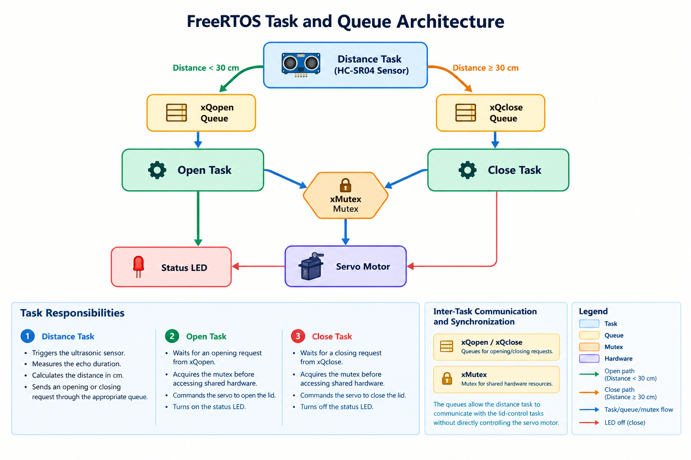

# Smart Trash Can Project: Arduino Mega 2560 & FreeRTOS

An embedded systems project that automates trash-can lid control using an ultrasonic distance sensor, a servo motor, and FreeRTOS.

## Overview

The Smart Trash Can detects a nearby person and automatically opens its lid when the measured distance is below 30 cm. When the measured distance is outside the detection threshold, the system requests the lid to close.

The project explores real-time embedded programming using FreeRTOS on an Arduino Mega 2560, with separate tasks for distance measurement and lid control.

## Features

- Automatic lid opening and closing based on distance measurements.
- Ultrasonic distance sensing.
- Task-based firmware architecture using FreeRTOS.
- Inter-task communication through queues.
- Mutex-based synchronization of shared hardware resources.
- Servo motor control and LED status indication.
- PlatformIO-based development and build workflow.

## Hardware Components

| Component | Purpose |
|---|---|
| Arduino Mega 2560 | Main controller |
| HC-SR04 ultrasonic sensor | Measures distance to a nearby person |
| Servo motor | Opens and closes the lid |
| LED | Indicates lid status |
| Trash-can enclosure | Physical prototype |

## Pin Configuration

| Signal | Arduino pin |
|---|---:|
| Ultrasonic TRIG | 22 |
| Ultrasonic ECHO | 24 |
| Servo signal | 10 |
| Status LED | 26 |


## Software Architecture

The firmware is organized into three FreeRTOS tasks.


### FreeRTOS Task and Queue Diagram
The diagram below illustrates the three FreeRTOS tasks, inter-task
communication through queues, and mutex-based resource synchronization.



### Task Responsibilities

**1. Distance Task (`distance_task`)**

- Triggers the ultrasonic sensor.
- Measures the echo duration.
- Calculates the distance in centimeters.
- Sends an opening or closing request through the appropriate queue.

**2. Open Task (`open_task`)**

- Waits for an opening request from `xQopen`.
- Acquires the mutex before accessing the shared hardware.
- Commands the servo to open the lid.
- Turns on the status LED.

**3. Close Task (`close_task`)**

- Waits for a closing request from `xQclose`.
- Acquires the mutex before accessing the shared hardware.
- Commands the servo to close the lid.
- Turns off the status LED.

### Inter-Task Communication and Synchronization

- **`xQopen`:** Queue used to transmit opening requests.
- **`xQclose`:** Queue used to transmit closing requests.
- **`xMutex`:** Mutex used to coordinate access to shared hardware resources.

The queues allow the distance task to communicate with the lid-control tasks without directly controlling the servo motor.

## Development Environment

- **Language:** C/C++
- **Framework:** Arduino
- **Real-time operating system:** FreeRTOS
- **Build environment:** PlatformIO
- **Servo control:** Arduino Servo library

## Getting Started

### Prerequisites

- Visual Studio Code
- PlatformIO IDE extension
- Compatible Arduino Mega 2560 board
- Required sensor, servo, and LED hardware

### Build the Project

1. Clone the repository:

   ```bash
   git clone https://github.com/JesserBenNasr/smart-trash-can.git
   ```

2. Open the project folder in Visual Studio Code.

3. Ensure the dependencies declared in `platformio.ini` are installed.

4. Compile the firmware:

   ```bash
   pio run
   ```

5. If the compatible board is connected, upload the firmware:

   ```bash
   pio run --target upload
   ```

6. Open the serial monitor:

   ```bash
   pio device monitor
   ```

The serial monitor runs at 9600 baud with the current firmware configuration.


## Demonstration

Watch the Smart Trash Can prototype in action:

▶️ **[Watch the Demo Video](https://drive.google.com/file/d/1gOzuoYr3H7Xmm8Jboj7GWVWwMjpzvkvn/view?usp=sharing)**

The video demonstrates the automatic lid-opening and closing mechanism based on ultrasonic distance detection.

## Skills Demonstrated

- Embedded C/C++ development.
- Real-time task management with FreeRTOS.
- Inter-task communication using queues.
- Shared-resource synchronization using a mutex.
- Sensor and actuator integration.
- Microcontroller firmware development.
- PlatformIO build and debugging workflow.
